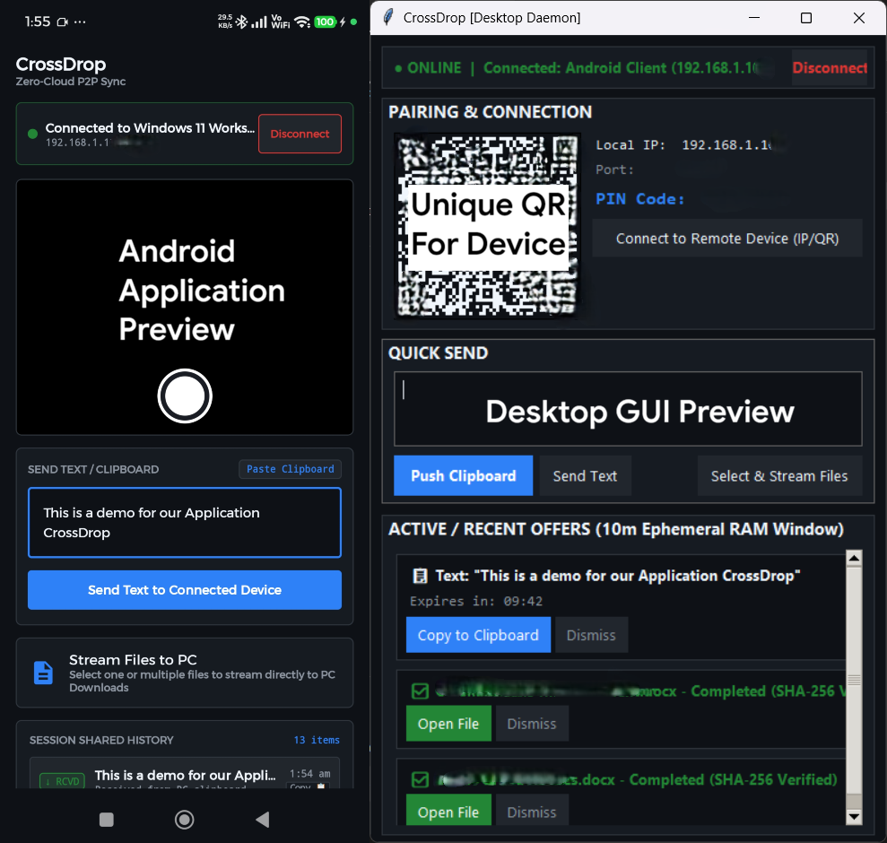

# JiffBoltP2P

<p align="center">
  
</p>

**JiffBoltP2P** is an ultra-lightweight, zero-cloud peer-to-peer (P2P) sync utility operating directly between a Windows 11 PC and an Android device (API 26 to 34) on the local network. It's built for seamless, clean file and text transfers between your PC and phone—zero cloud processing, zero staging to intermediate temporary disk files, no popups or account logins, and no external relay servers!

---

## 1. Core Philosophy & Invariants

1. **Zero-Cloud / Zero-Relay:** All network traffic terminates strictly across the local Wi-Fi subnet over a direct TCP pipe on port `58241` (mobile listening on `58242`). No external servers, cloud databases, or third-party relay infrastructure exist.
2. **Zero-Disk Intermediate Footprint:** Neither mobile nor desktop writes `.tmp` files, cache images, or stages media to persistent flash/disk prior to explicit user authorization.
3. **10-Minute Volatile RAM Buffer:** Inbound transfer offers (text payloads or file metadata) reside exclusively in volatile memory. A strict 600-second TTL timer starts on arrival. If unaccepted at $t = 600\text{s}$, the memory reference is zeroed out and purged, the sender is notified of a timeout, and the socket closes cleanly.
4. **Active-Lock Pipeline:** Once the recipient clicks "Accept" or "Download", the TCP socket enters a dedicated transfer lock, streaming 64 KB chunks until transmission finishes and the trailing SHA-256 digest is verified.
5. **Direct-from-Camera Shutter:** CameraX captures raw camera frames directly into an in-memory `ByteBuffer` and streams across the socket without saving intermediate photos to mobile storage.

---

## 2. Key Features

### 🖥️ Windows Desktop Daemon (v1.2.0)
- **Universal Input & Staging Area:** 
  - **Drag-and-Drop:** Drag multiple files directly from File Explorer into the quick window.
  - **Clipboard Image Pasting (`Ctrl+V`):** Take a screenshot or copy an image anywhere, press `Ctrl+V` in JiffBoltP2P to stage it immediately.
  - **Visual Thumbnails & Badges:** Image thumbnails (with modal preview on click) and document badges (`PDF`, `DOCX`, `ZIP`, etc., with double-click to launch). Individual removal (`✕`) on badges.
  - **Explicit Send:** Files and custom text remain safely staged until you click **"Send to Connected Device"**—no accidental transmissions.
- **Per-Monitor DPI Awareness (V2):** Native `shcore.SetProcessDpiAwareness(2)` ensures crisp UI fonts, sharp borders, and high-DPI scaling across multi-monitor setups without Windows bitmap blur.
- **Persistent Text Offers with "Copy Again":** Inbound text snippets remain in the 10-minute volatile RAM buffer even after copying to clipboard; the action button smoothly toggles to **"Copy Again"** with secondary styling.
- **Integrated Outgoing Stream Monitor:** Real-time upload progress bar positioned right below Quick Send with instant `✕ Dismiss` controls.
- **System Tray Daemon:** Runs quietly in the notification area with a dynamic connection status icon, quick clipboard push, and native Windows 11 actionable toast notifications.
- **Pairing & PIN:** Instant QR code display and 6-digit PIN verification for rapid mobile onboarding.

### 📱 Android Mobile Client (v1.2.1)
- **Front & Back Camera Toggle:** One-tap camera flip button on the viewfinder overlay with live `FRONT CAM` / `BACK CAM` status badge to easily stream selfies or environment photos directly to PC.
- **One-Tap "Open Downloads Folder":** Prominent quick-access button right below Session Shared History to immediately launch the Android system Downloads file explorer.
- **System Share Sheet Integration:** Appears in the native Android **"Share"** menu (`ACTION_SEND` and `ACTION_SEND_MULTIPLE`) across any app (Gallery, WhatsApp, Files, Browser) to stream shared files or text directly to PC with a single tap.
- **Immediate MediaStore Recents Discoverability:** Downloaded files are saved cleanly into the public `Download` directory and immediately indexed via Android `MediaScannerConnection`—instantly visible in WhatsApp, Instagram, Telegram, and Android Recents file pickers.
- **Live Camera Shutter Stream:** Viewfinder captures JPEG frames straight to volatile `ByteBuffer` and streams directly to PC with zero intermediate storage writes.
- **Quick Clipboard Push:** Auto-detects copied text on app focus with a one-tap **"Push Clipboard to PC Now"** tile.
- **Arbitrary File Streaming:** Send any image, video, document, or archive from the system file picker.
- **Auto-Discovery (mDNS / NSD):** Automatically detects the desktop daemon on the Wi-Fi subnet (`_jiffboltp2p._tcp.local.`), with backward-compatible support and manual IP/port override.
- **Ephemeral RAM Buffer:** Incoming file offers countdown with a live 10-minute timer. Offers can be accepted, downloaded with real-time progress, or dismissed.

---

## 3. Pre-Compiled Releases

Pre-compiled standalone binaries are available in the [`release/`](release/) folder and on GitHub Releases:

| Platform | Binary | Version | Notes |
| :--- | :--- | :--- | :--- |
| **Android** | `JiffBoltP2P-Android-v1.2.1.apk` | **v1.2.1** | Front/Back camera toggle, Open Downloads Folder button, Share Sheet & MediaStore Recents. |
| **Windows 11** | `JiffBoltP2P-Windows-v1.2.0.exe` | **v1.2.0** | Standalone single-file executable with DPI awareness, tray icon, staging, and outgoing monitor. |
| **Android (v1.2.0)** | `JiffBoltP2P-Android-v1.2.0.apk` | **v1.2.0** | Initial rebrand release with Share Sheet & MediaStore. |
| **Windows 11 (Legacy)** | `BoltP2P-Windows-v1.1.1.exe` | **v1.1.1** | Prior stable desktop release. |
| **Android (Legacy)** | `BoltP2P-Android-v1.1.0.apk` | **v1.1.0** | Prior stable mobile release. |

---

## 4. System Architecture & Wire Protocol

```
+---------------------------------------------------------------------------------+
|                                Local Wi-Fi Subnet                               |
|                                                                                 |
|   +--------------------------+                       +----------------------+   |
|   |    Android Client App    | <==== mDNS / NSD ===> |  Windows 11 Daemon   |   |
|   | (Jetpack Compose / Java) | (_jiffboltp2p._tcp.)  |  (Python 3.14 Async) |   |
|   +--------------------------+                       +----------------------+   |
|                |                                                 |              |
|                +============ Direct TCP Pipe (Port 58241) =======+              |
|                             Custom 18-Byte Binary Framing                       |
+---------------------------------------------------------------------------------+
```

### 18-Byte Big-Endian Frame Header

Every packet transmitted over the socket begins with a fixed 18-byte big-endian header:

```
 0                   1                   2                   3
 0 1 2 3 4 5 6 7 8 9 0 1 2 3 4 5 6 7 8 9 0 1 2 3 4 5 6 7 8 9 0 1
+-+-+-+-+-+-+-+-+-+-+-+-+-+-+-+-+-+-+-+-+-+-+-+-+-+-+-+-+-+-+-+-+
|                       Magic: "XDRP"                           |
+-+-+-+-+-+-+-+-+-+-+-+-+-+-+-+-+-+-+-+-+-+-+-+-+-+-+-+-+-+-+-+-+
|          Msg Type (2B)        |      Meta Length (4B)         |
+-+-+-+-+-+-+-+-+-+-+-+-+-+-+-+-+-+-+-+-+-+-+-+-+-+-+-+-+-+-+-+-+
|                      Payload Length (8B)                      |
|                                                               |
+-+-+-+-+-+-+-+-+-+-+-+-+-+-+-+-+-+-+-+-+-+-+-+-+-+-+-+-+-+-+-+-+
|                  JSON Metadata Block (UTF-8)                  |
|                  (Length = Meta Length)                       |
+-+-+-+-+-+-+-+-+-+-+-+-+-+-+-+-+-+-+-+-+-+-+-+-+-+-+-+-+-+-+-+-+
|                  Raw Binary Payload Stream                    |
|                  (Length = Payload Length)                    |
+-+-+-+-+-+-+-+-+-+-+-+-+-+-+-+-+-+-+-+-+-+-+-+-+-+-+-+-+-+-+-+-+
```

### Protocol Message Types

| Value | Identifier | Purpose |
| :--- | :--- | :--- |
| `0x0001` | `PING` / `PONG` | Heartbeat & pipe keep-alive |
| `0x0002` | `OFFER_TEXT` | Push clipboard or text snippet |
| `0x0003` | `OFFER_FILE` | Inbound file or live camera frame offer |
| `0x0004` | `ACCEPT_TRANSFER` | Recipient consent to begin active streaming |
| `0x0005` | `REJECT_TRANSFER` | Recipient declined or 10-minute TTL expired |
| `0x0006` | `DATA_CHUNK` | 64 KB binary stream chunk |
| `0x0007` | `TRANSFER_FIN` | End of stream + trailing SHA-256 digest |
| `0x0008` | `TRANSFER_ACK` | SHA-256 verified; receiver confirms success |

---

## 5. Environment & Prerequisites

- **Host OS:** Windows 11 (x64)
- **Python:** 3.11 or 3.14 (Native 64-bit)
- **Java Runtime:** Eclipse Temurin OpenJDK 21 LTS (`java -version` -> 21)
- **Android SDK:** Configured at `C:\Android`
  - Platform: `android-34`
  - Build-Tools: `34.0.0`
  - Platform-Tools: `adb.exe` v1.0.41+
- **Physical Device:** Android smartphone running Android 8.0+ (API 26 to 34), connected via USB with "USB Debugging" enabled under Developer Options.

### Environment Variables Verification

Ensure the following variables are present in your session:

```powershell
$env:ANDROID_HOME = "C:\Android"
$env:PATH = "C:\Android\platform-tools;C:\Android\cmdline-tools\latest\bin;$env:PATH"
```

---

## 6. Quick Start & Execution Guide

### 6.1 Running the Windows 11 Desktop Daemon

1. Navigate to the desktop directory:
   ```powershell
   cd jiffboltp2p-desktop
   ```

2. Install dependencies:
   ```powershell
   pip install -r requirements.txt
   ```

3. Launch the daemon:
   ```powershell
   python main.py
   ```
   - The daemon will minimize to the system tray with a geometric status icon.
   - Right-click the tray icon to **"Open JiffBoltP2P"** (bringing up the quick window), **"Push Clipboard to Phone"**, or **"Send File..."**.
   - Native Windows 11 actionable notifications will automatically trigger when text or files arrive.

---

### 6.2 Building & Deploying the Android Mobile Client

1. Verify physical phone is connected via ADB:
   ```powershell
   adb devices
   ```
   *(Ensure device shows up as `device`, not `unauthorized`)*

2. Navigate to the android client directory:
   ```powershell
   cd jiffboltp2p-android
   ```

3. Compile the debug APK using the headless Gradle wrapper:
   ```powershell
   .\gradlew.bat assembleDebug
   ```

4. Install the application onto the connected phone:
   ```powershell
   adb install -r app\build\outputs\apk\debug\app-debug.apk
   ```

5. Launch the client directly via ADB:
   ```powershell
   adb shell am start -n com.jiffboltp2p.client.debug/com.jiffboltp2p.client.MainActivity
   ```

---

### 6.3 Compiling Standalone Windows 11 Executable (`JiffBoltP2P.exe`)

To build the windowless, standalone `.exe`:

1. Navigate to the desktop directory:
   ```powershell
   cd jiffboltp2p-desktop
   ```

2. Run the packaging script:
   ```powershell
   python build_exe.py
   # Or run: .\build_exe.bat
   ```

3. The standalone binary is produced at:
   ```
   jiffboltp2p-desktop\dist\JiffBoltP2P.exe
   ```

4. Launch the binary in the background:
   ```powershell
   Start-Process .\dist\JiffBoltP2P.exe
   ```

---

## 7. Mobile Client Usage

- **System Share Sheet:** Tap "Share" on any photo, video, document, or text in any Android app (e.g. Gallery, Files, WhatsApp) and select **JiffBoltP2P** to instantly push it to your desktop.
- **Instant Discoverability:** All files received on Android are stored in your primary `Download` folder and registered with Android's MediaStore, appearing immediately at the top of recent files when attaching media in WhatsApp, Instagram, or Telegram.
- **Camera Direct Shutter:** Tap the shutter button in the center viewfinder. The camera captures the JPEG into a memory `ByteBuffer` and immediately streams it to your PC. A slim 2px progress bar on top tracks transmission.
- **Quick Clipboard Push:** When you copy text anywhere on Android and open JiffBoltP2P, the clipboard snippet is automatically detected. Tap **"Push Clipboard to PC Now"** to instantly dispatch it to Windows.
- **Arbitrary File Transfer:** Tap **"Stream File"** to pick any document, video, or archive and send it to your PC.
- **PC Target:** The app automatically discovers your PC via mDNS (`_jiffboltp2p._tcp.local.`). You can also tap the status pill or **"PC Target"** tile to manually set the PC IP address and port.

---

## 8. Troubleshooting & Diagnostics

| Issue | Cause | Solution |
| :--- | :--- | :--- |
| **"Connection refused" or red dot on phone** | Windows Firewall blocking port 58241 | Run in elevated PowerShell: `New-NetFirewallRule -DisplayName "JiffBoltP2P" -Direction Inbound -LocalPort 58241 -Protocol TCP -Action Allow` |
| **mDNS Auto-Discovery fails** | Wi-Fi router AP Isolation enabled | Router blocks multicast between devices. Manually enter PC's IP address (from `ipconfig`) in JiffBoltP2P Mobile Target Settings. |
| **Toast notifications do not show** | Windows Focus Assist / Do Not Disturb | Check Windows 11 Settings > System > Notifications and ensure notifications are enabled for Python/Terminal. |
| **ADB device unauthorized** | Phone screen locked or RSA key unaccepted | Unlock phone screen and tap "Always allow from this computer" on the USB Debugging prompt. |
| **Transfer SHA-256 Mismatch** | Network packet loss or stream truncated | JiffBoltP2P automatically deletes corrupted partial writes on integrity failure. Retry transfer on stable Wi-Fi. |
